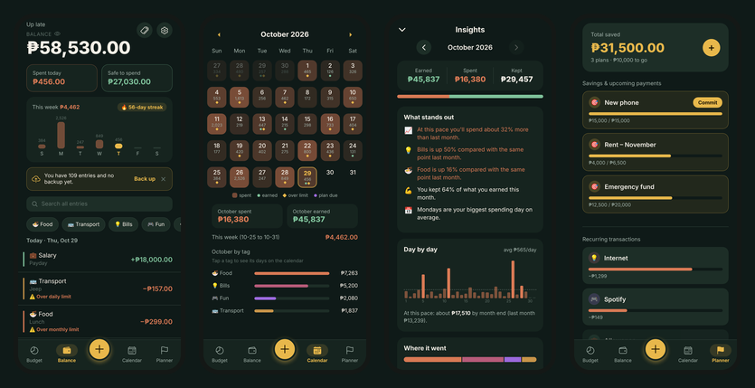
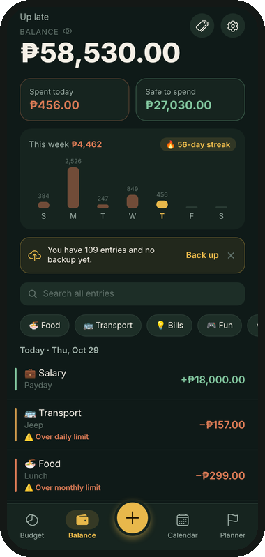
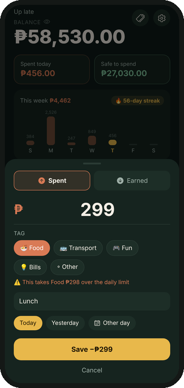
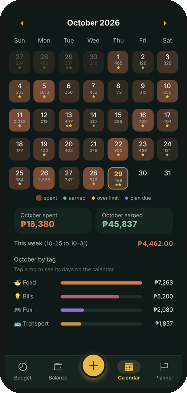
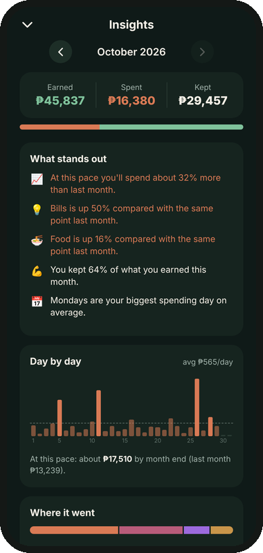
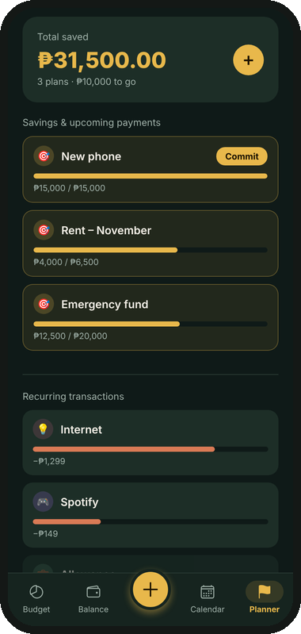
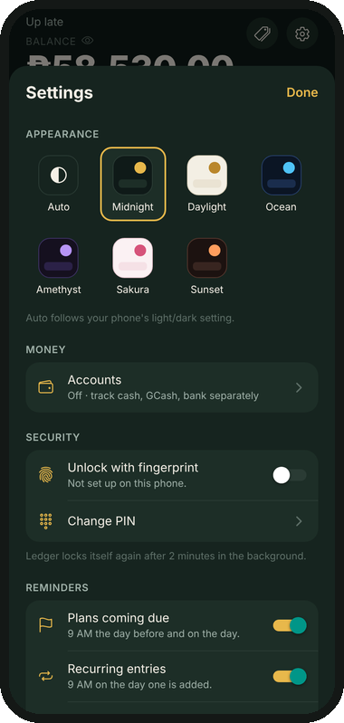

# Ledger

A personal, PIN-protected budgeting app for Android, built with React Native and Expo.
Everything stays on your phone: no account, no server, no ads.



## What it does

**Log money fast**
- One-tap **+** button with *Quick add* shortcuts that learn what you log often, tags sorted by how much you use them, description suggestions, and Today / Yesterday buttons.
- A live hint while you type ("₱120 left for Food today"), a warning when an entry pushes a tag over its limit, and **Undo** after every save or delete.
- Optional **accounts** (Cash, GCash, Maya, Bank…) with per-account balances and *Move money* between them.

- **Pictures & GIFs** on entries in three looks (Fade, Glass, Clear), stored privately inside the app.

**See where it goes**
- **Balance**: balance, spent today, *safe to spend* (minus money set aside for plans), and a logging streak 🔥.
- **Calendar heat map**: every day shows what you spent, shaded by how heavy it was. Tap a tag to highlight the days you spent on it.
- **Insights** (card on the Balance screen): earned / spent / kept, plain-English observations, day-by-day chart with a month-end projection, spending by tag vs last month, your heaviest weekday, biggest expenses, a 6-month trend, and **badges**.
- **Budgets**: daily, weekly and monthly limits per tag, "about ₱X a day left this month", and suggested limits based on what you usually spend.

**Plan ahead**
- **Plans** for savings and upcoming payments, each with its own icon and colour, due dates, a "set aside ₱X a day" pace and one-tap top-ups. Commit a plan to record it as an expense.
- **Recurring entries**: monthly, weekly, or **twice a month** (15th + month end).
- **Lent & borrowed**: keep track of utang both ways, with partial pay-backs.
- **Reminders** for plans coming due and recurring entries, plus an optional evening "log today?" nudge.

**Safe and private**
- 4-digit PIN (stored in encrypted secure storage), optional **fingerprint unlock**, lockout after 5 wrong tries, auto-lock after 2 minutes in the background, and a *hide amounts* eye.
- **Backup & restore** to a single file (save it to Google Drive or email), and **export to CSV** for Excel / Google Sheets.
- 18 themes plus Auto (follows the phone's dark mode), a custom accent colour, and an 80-colour palette.

| | | |
|---|---|---|
|  |  |  |
|  |  |  |

## Install (Android)

Download the latest `.apk` from the [Releases](../../releases) page and open it on your phone.
Android will ask you to allow installing from this source the first time.

**Updating:** install the new APK *over* the old one. Don't uninstall first, or your data is erased.
Make a backup first anyway (Settings → Back up now).

## Develop

```bash
npm install
npx expo start          # scan the QR code with Expo Go
```

Build an installable APK with [EAS Build](https://docs.expo.dev/build/introduction/):

```bash
npm install -g eas-cli
eas login
eas build --platform android --profile preview
```

Or use GitHub → **Actions** → *Build Android APK* (needs an `EXPO_TOKEN` repository secret).
Pushing a tag like `v2.0.0` builds the APK and attaches it to a GitHub Release.

## Project structure

```
App.js                    entry point: providers, tab bar, data loading, reminders
components/
  FeedScreen.js           Balance screen
  CalendarScreen.js       calendar heat map + day sheet
  BudgetScreen.js         spending limits
  InsightsScreen.js       insights, trends, badges
  PlannerScreen.js        plans, recurring entries, lent & borrowed
  AddTransactionSheet.js  the + sheet
  SettingsModal.js        themes, security, reminders, backup, accounts
  PinScreen.js · WelcomeFlow.js
  accounts.js · AccountsUI.js   optional accounts + transfers
  iou.js · IouManager.js        lent & borrowed
  backup.js               backup / restore / CSV
  notifications.js        local reminders
  insights.js             pure calculations behind Insights, badges, streaks
  overLimit.js            limit checks
  recurringEngine.js      creates recurring entries when due
  storage.js · categories.js · goals.js · recurring.js   persistence
  theme.js · prefs.js · toast.js · haptics.js · format.js · dateUtils.js
scripts/update-app-json.js      one-time app.json helper for the v2 update
```

## Data & privacy

All data lives on the device in AsyncStorage; the PIN is kept separately in encrypted secure storage.
Nothing is sent anywhere. Backups only go where you choose to save the file.

## License

Personal project. Add a license (e.g. MIT) here if you'd like to share the source code publicly.
